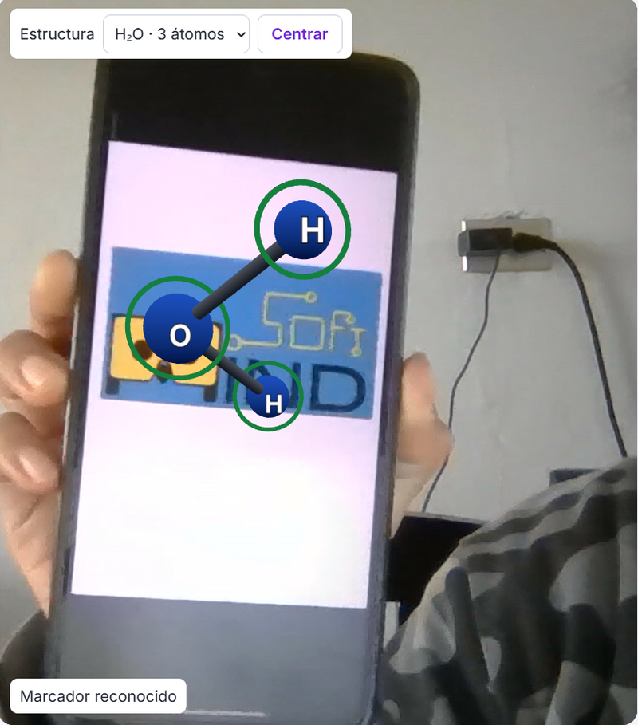
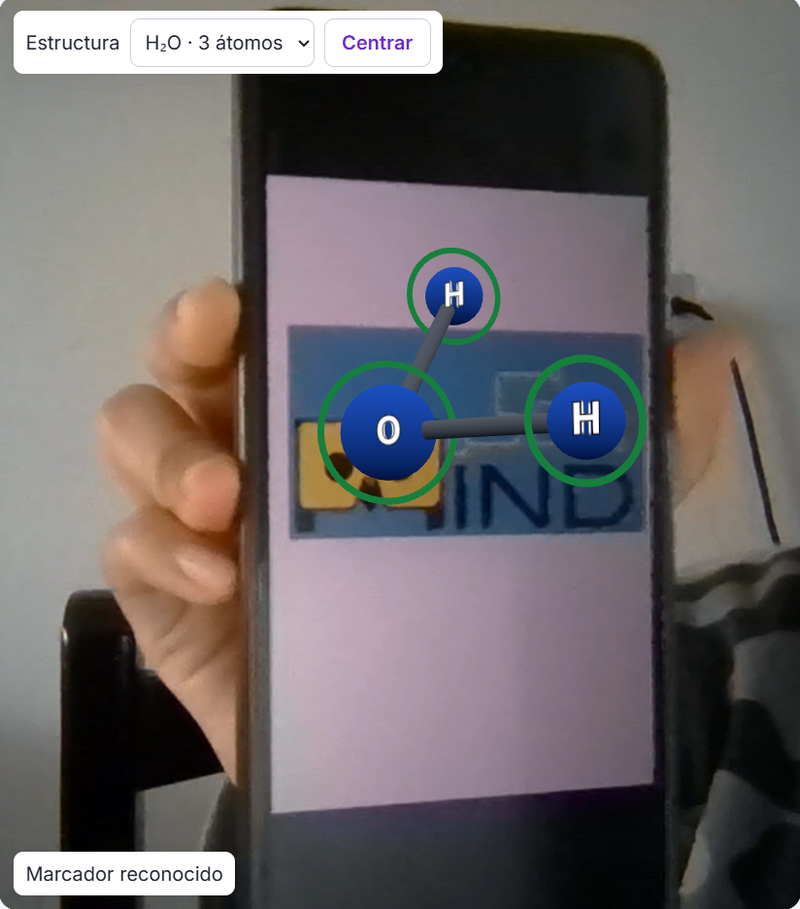
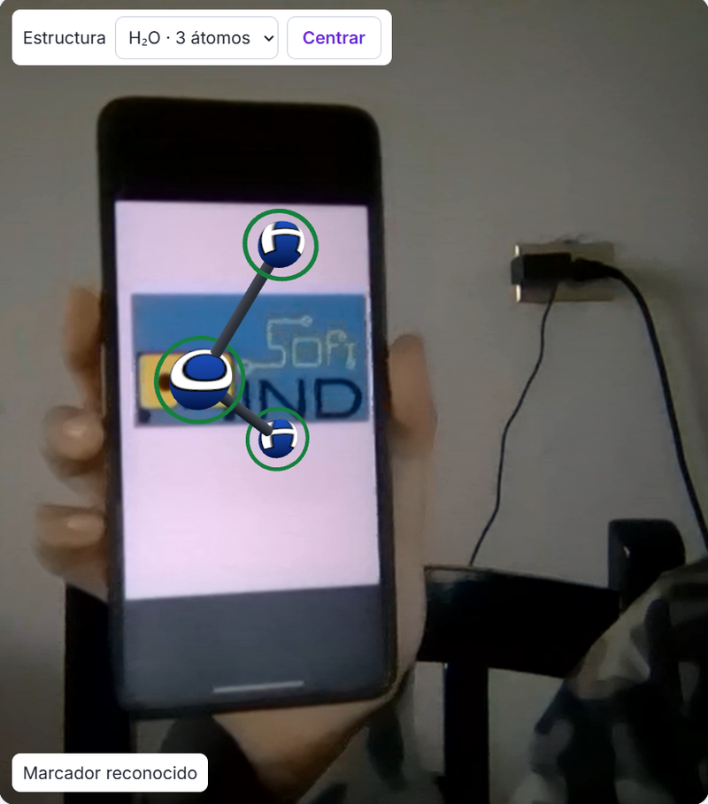
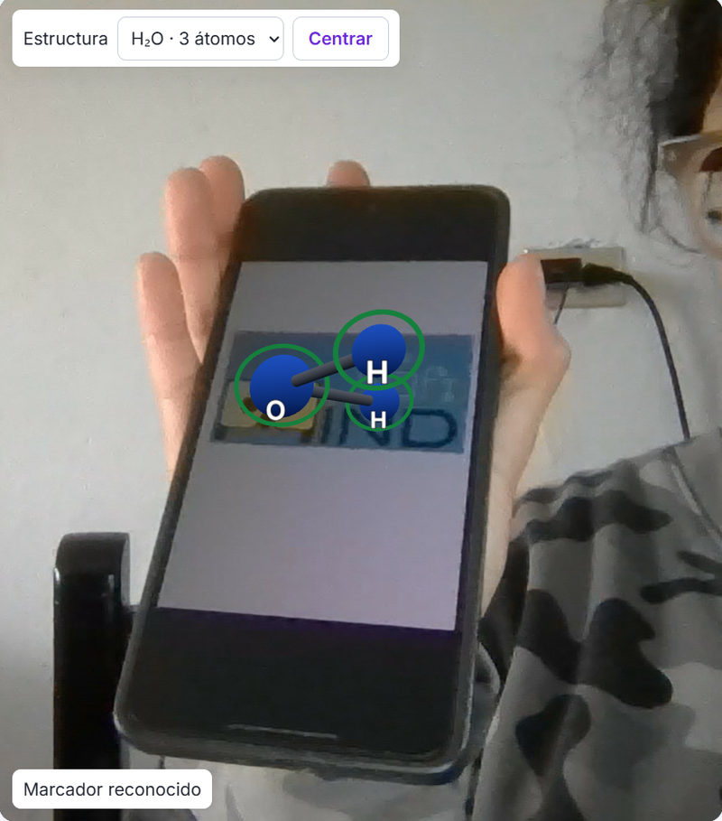
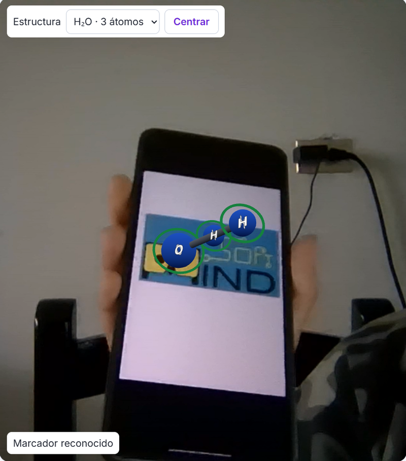
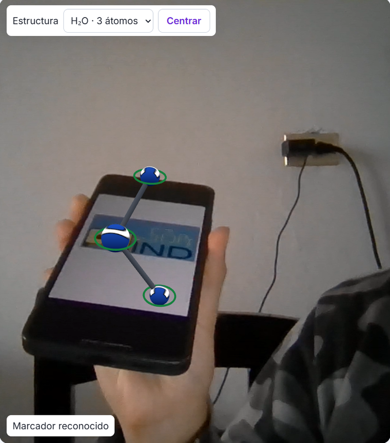

# Realidad aumentada en MolecuLab: propuesta, decisiones y avances

Documento de seguimiento del módulo de realidad aumentada (RA). Resume la propuesta acordada, las decisiones tomadas, los cambios realizados en cada etapa y lo que queda pendiente.

Última actualización: 22 de noviembre de 2026.

---

## 1. Propuesta original

La propuesta busca que MolecuLab muestre las moléculas construidas en el editor sobre una tarjeta impresa, usando la cámara del equipo y la biblioteca MindAR (reconocimiento de imágenes) con Three.js.

Puntos principales de la propuesta:

1. **RA integrada en MolecuLab**, como un modo del editor, no como una aplicación aparte.
2. **Vista dividida** por defecto: editor a la izquierda, RA a la derecha. Se puede cambiar a solo editor o solo RA.
3. **Marcador propio** de 8 × 8 cm, compilado en formato `.mind`.
4. **Actualización incremental**: al mover un átomo solo se actualiza su representación y sus enlaces.
5. **Pausa de la detección de manos** mientras la RA está activa, porque MindAR y MediaPipe no pueden usar la cámara al mismo tiempo.
6. **Android con Scene Viewer** (vista de realidad aumentada nativa) como segunda fase, con un catálogo de archivos GLB.
7. **Gestos en RA** como trabajo posterior.

Las etapas previstas fueron:

| Etapa | Contenido                                                                                |
| ----- | ---------------------------------------------------------------------------------------- |
| 0     | Preparación de la arquitectura (extraer geometría a `modelos.js`, eventos nuevos).       |
| 1     | Investigación y prototipo aislado: Scene Viewer, marcador y compatibilidad MindAR–Three. |
| 2     | Modo RA dentro de MolecuLab: botón, vistas, pausa de manos y molécula de prueba.         |
| 3     | Estructura viva: mapa de objetos y actualización incremental.                            |
| 4     | Selección de estructuras a visualizar.                                                   |
| 5     | Etiquetas de los átomos en RA.                                                           |
| 6     | Android: página con model-viewer y manifiesto de modelos.                                |
| 7     | Gestos en RA y estructuras personalizadas en Android (posterior).                        |

---

## 2. Decisiones tomadas

### Diseño y marcador

- **Marcador universal de 8 × 8 cm**, único para todas las moléculas (catálogo y construcciones del estudiante).
- Se usa un marcador de prueba (`ar/marcador.mind`) hasta tener el definitivo.
- **Escala fija:** 1 unidad = ancho de la tarjeta; la estructura usa una escala de 0.3.
- **Orientación:** las estructuras se giran 90° sobre el eje X para quedar **planas sobre la tarjeta**, como en el tablero del editor.

### Interfaz

- **Vista dividida** por defecto, con selector «Dividida / Solo editor / Solo RA» en el encabezado (visible solo con la RA activa).
- El **botón «Realidad aumentada»** está en la barra de respaldo, junto a «Pizarra».
- La **cámara flotante de manos** se oculta mientras la RA está activa.
- El **mensaje de escena vacía** aparece sobre la tarjeta.

### Cámara y recursos

- La RA **reutiliza la cámara** solo mientras está activa: al entrar se pausa la detección de manos y al salir se liberan las pistas de la cámara y se reanudan las manos.
- Si se **niega la cámara**, la RA se apaga sola y aparece un aviso con la alternativa (editor con mouse o teclado).
- MindAR se **importa al encender la RA**, no al cargar la página.

### Datos y editor

- **No se modifica el editor.** La RA lee la estructura con `obtenerListaAtomos()` y `obtenerListaEnlaces()`, y escucha los eventos existentes del bus.
- **No se añaden eventos nuevos** al contrato, salvo `escena:atomo-desplazado` y `escena:reconstruir`, añadidos en la Etapa 0.

### Estructuras (Etapa 4 corregida)

- Una **estructura** es un grupo de átomos unidos por enlaces (incluye átomos sueltos y estructuras incompletas).
- Se detectan con **búsqueda de componentes conexos** sobre los ids y los enlaces que ya expone el editor.
- La **selección sigue al átomo ancla**: si se unen estructuras, se conserva la que contiene el ancla; si se separan, la que lo contiene; si el ancla se elimina, se elige la más grande.
- Si hay **una sola estructura**, se selecciona automáticamente.
- Cada estructura se **centra en el origen** al seleccionarla, al cambiar su composición y con el botón «Centrar». Mover átomos no la recentra.
- El **nombre** de cada estructura es su **fórmula por conteo** (sin comparar con el catálogo), con el orden de Hill, por ejemplo `CH₄ · 5 átomos`.
- El **catálogo** (`data/moleculas.json`) se conserva para el editor, la verificación y el modo reto, pero **no se usa en la RA**.

### Otras decisiones

- El **modelo de Bohr** no se muestra en RA.
- Los **ids de átomos** son fiables dentro de una sesión: `elemento + número`, sin reutilizarse, y la importación valida que no se repitan.

---

## 3. Avances por etapa

### Etapa 0 — Preparación de la arquitectura · **Cerrada**

- Geometría de átomos y enlaces extraída a `js/modelos.js`.
- Eventos `escena:atomo-desplazado` (en cada cuadro del arrastre) y `escena:reconstruir` (deshacer, rehacer, importar).
- Verificado por el equipo.

### Etapa 1 — Investigación y prototipo · **Cerrada**

- Prototipo en `pruebas/ar-prototipo.html` con MindAR 1.2.5 y Three.js 0.183.2 (compatibles).
- Verificación de compatibilidad MindAR–Three.
- **Pendiente de la etapa:** prueba de Web Share con Scene Viewer en Android (la realizará el equipo).

### Etapa 2 — Modo RA dentro de MolecuLab · **Cerrada**

Archivos: `js/ra.js` (nuevo), `index.html`, `css/styles.css`, `css/responsive.css`, `js/main.js`.

- Botón de RA, selector de vistas, contenedor `#lienzo-ra` y clase `modo-ra`.
- Pausa de manos al encender y reanudación al apagar.
- Verificado en Chrome por el equipo: el marcador se reconoce.

**Problemas encontrados y resueltos durante la etapa:**

| Problema                    | Causa                                                                                            | Solución                                                                 |
| --------------------------- | ------------------------------------------------------------------------------------------------ | ------------------------------------------------------------------------ |
| El marcador no se reconocía | La entrada de MindAR tenía 640 × 480 fijos, distinta de la resolución real de la cámara          | Usar `videoWidth` y `videoHeight` reales                                 |
| El cuadro salía recortado   | Los atributos `width` y `height` del video no se fijaban; MindAR dibuja el cuadro con ese tamaño | Fijar los atributos a la resolución nativa, igual que el ejemplo oficial |
| Firefox no funcionaba       | Problemas del navegador con MediaPipe y MindAR                                                   | Usar Chrome (navegador de pruebas del proyecto)                          |

### Etapa 3 — Estructura viva · **Cerrada**

Archivo: `js/ra.js`.

- La RA muestra la molécula del editor, actualizada en vivo.
- **Actualización incremental:** mover un átomo solo cambia su representación y sus enlaces.
- **Reconstrucción completa** solo al limpiar, importar, deshacer o rehacer.
- Anillos de valencia calculados con `chemistry.js`, igual que en el editor.
- Pruebas automáticas: 19 comprobaciones pasaron.

### Etapa 4 — Selección de estructuras · **Cerrada (versión corregida)**

Archivos: `js/ra.js`, `index.html`, `css/styles.css`.

Hubo una versión intermedia con selector de catálogo. Se reemplazó por la versión final, que se describe aquí.

- Selector de estructuras con fórmula por conteo y número de átomos.
- Detección de grupos conectados, selección por átomo ancla y reglas de unión, separación y eliminación.
- Centrado de la estructura elegida, con botón «Centrar».
- Mensaje de escena vacía y selección automática con una sola estructura.
- Pruebas automáticas: 24 comprobaciones pasaron. Las etapas 2 y 3 siguen pasando.
- **Verificación del editor:** los módulos del editor no cambiaron respecto a sus originales.

**Verificada en Chrome por el equipo:** el flujo completo con la cámara y el marcador funciona.

### Etapa 5 — Etiquetas · **Cerrada**

Archivos: `js/modelos.js` (nuevas `crearEtiquetaCruzada` y `crearEtiquetaEsfera`) y `js/ra.js` (constante `MODO_ETIQUETA`, función `aplicarEtiquetaRA`). La función `crearEtiqueta` del editor no cambió.

Se compararon tres formas de etiqueta en la RA, con la misma molécula (H₂O) y la misma tarjeta de prueba, en Chrome:

| Modo     | Vista desde arriba                            | Vista inclinada                   | Resultado   |
| -------- | --------------------------------------------- | --------------------------------- | ----------- |
| sprite   | Letras nítidas, derechas y centradas          | Letras nítidas y derechas         | **Elegido** |
| cruzados | Letras angostas: los dos planos se superponen | Letras pequeñas y sesgadas        | Descartado  |
| esfera   | Legible, con la curvatura de la esfera        | Difícil de leer en algunos átomos | Alternativa |

- **Decisión: sprite.** Es la más legible desde arriba y de lado, conserva la misma apariencia que las etiquetas del editor y no requiere cambios en la geometría.
- **Cruzados se descartó.** Desde arriba, los dos planos quedan en el mismo lugar y cada letra se ve comprimida a unos 70 % de su ancho, así que no forman una X visible.
- **Esfera queda como alternativa.** Se lee bien desde arriba, pero al inclinar la tarjeta la letra se distorsiona.
  **Capturas de la comparación** (H₂O, panel de RA; ver `docs/ra/`):

| Vista        | sprite                                                     | cruzados                                                     | esfera                                                     |
| ------------ | ---------------------------------------------------------- | ------------------------------------------------------------ | ---------------------------------------------------------- |
| Desde arriba |     |     |     |
| Inclinada    |  |  |  |

Las capturas de etanol (vista desde arriba e inclinada) se tomaron con sprite y sirven como referencia de una molécula más compleja. No se incluyó metano en la comparación.

- Las opciones `cruzados` y `esfera` se conservan en el código, detrás de `MODO_ETIQUETA`, para futuras comparaciones.

### Etapa 6 — Android · **Pendiente**

- `ar.html` con el manifiesto `ar/catalogo.json` y las 22 moléculas del catálogo en GLB.
- Cada molécula debe abrir en Scene Viewer desde GitHub Pages.
- Depende del resultado de la prueba de Web Share (Etapa 1).

### Etapa 7 — Posterior · **Pendiente**

- Gestos en RA y estructuras personalizadas en Android.

---

## 4. Limitaciones conocidas

- **Escala fija:** una estructura de hasta 20 átomos puede salirse de la tarjeta de 8 × 8 cm o amontonar las etiquetas.
- **Fórmula por conteo:** una estructura incompleta puede mostrar una fórmula que no corresponde a ninguna molécula conocida.
- **Recentrado al cambiar la composición:** agregar o quitar un átomo de la estructura elegida la recentra; mover átomos no.
- **Editor sin pausar en «Solo editor»:** la RA sigue procesando el video en segundo plano para volver rápido.
- **Chip de cámara:** muestra «Activa» mientras la RA usa la cámara, porque el contrato de eventos no tiene un estado para eso.
- **Recursos de `gestures.js`:** al reanudar las manos se crea un nuevo `HandLandmarker` y el anterior no se cierra. No se corrigió porque el módulo está fuera del alcance de la RA.
- **Marcador de prueba:** `ar/marcador.mind` es un prototipo; el definitivo de 8 × 8 cm se compilará después.
- **Navegador:** la RA se probó en Chrome. Firefox no es compatible por ahora.
- **Etiquetas sobre los enlaces:** la etiqueta sprite se dibuja encima de los enlaces, aunque estén detrás del átomo. Es el mismo comportamiento del editor y se aceptó por legibilidad.
- **Colores de grupo:** con los colores de `elementos.js`, H, C, N y O tienen el mismo azul, así que en la RA la letra es lo único que los distingue.

---

## 5. Pruebas realizadas

Las comprobaciones automáticas usan dobles de MindAR, Three.js, la cámara y el editor, en un DOM simulado (jsdom). No reemplazan la prueba con cámara real.

| Etapa         | Comprobaciones | Resultado                                                   |
| ------------- | -------------- | ----------------------------------------------------------- |
| 2             | 38             | Pasan (encender, vistas, apagar, cámara denegada)           |
| 3             | 19             | Pasan (alta, movimiento, enlaces, reconstrucción, limpieza) |
| 4 (corregida) | 24             | Pasan (grupos, selección, unión, separación, centrado)      |

Además, la geometría real de `molecules.js` se verificó sobre las 22 moléculas del catálogo: todos los átomos reciben posición válida.

**Pruebas en el equipo (Chrome):** reconocimiento del marcador confirmado y flujo completo de la Etapa 4 verificado con la cámara. Comparación de etiquetas de la Etapa 5 con seis capturas, descrita en el apartado de la Etapa 5.

---

## 6. Pendientes y próximos pasos

1. Confirmar la escala con el marcador definitivo de 8 × 8 cm.
2. Decidir si los átomos usan los colores de grupo de `elementos.js` o los colores estándar de la Guía visual. Con los colores actuales, H, C, N y O se ven igual de azules.
3. Etapa 6: prueba de Web Share con Scene Viewer (Android) y `ar.html` con el manifiesto.
4. Revisar el catálogo oficial: la documentación dice 15 moléculas y `moleculas.json` tiene 22.
